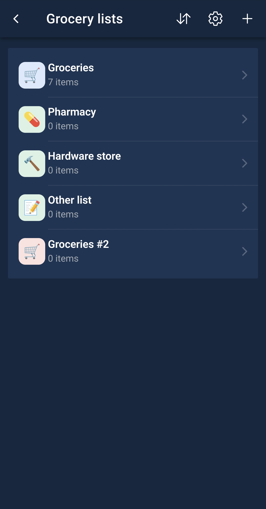
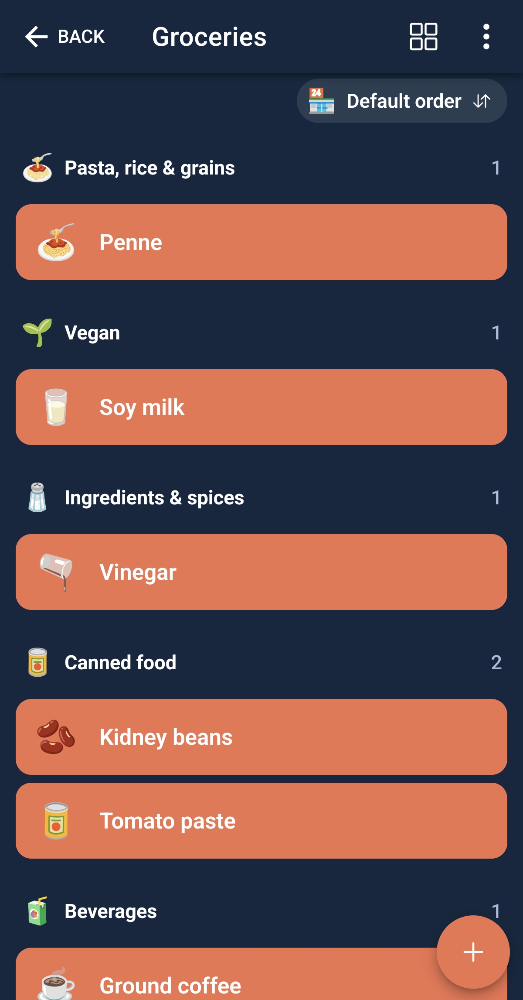
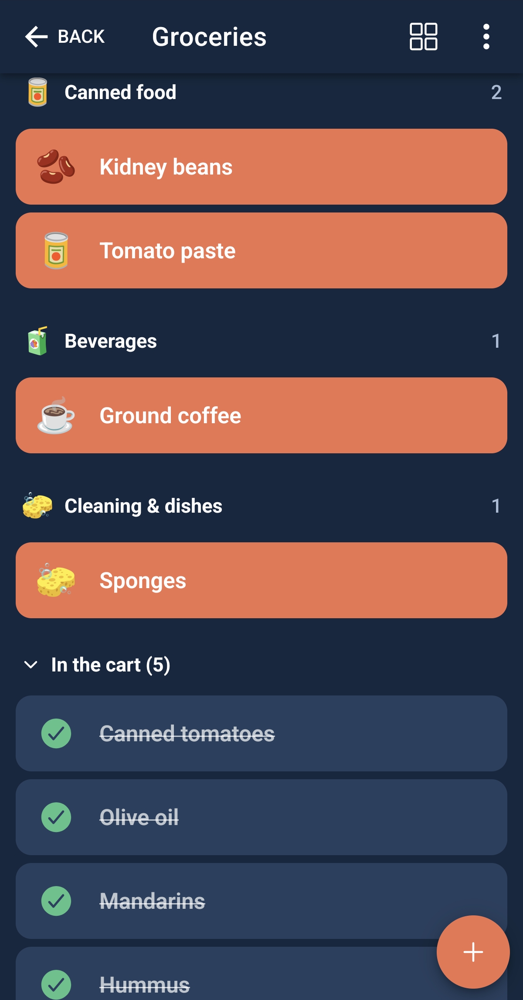
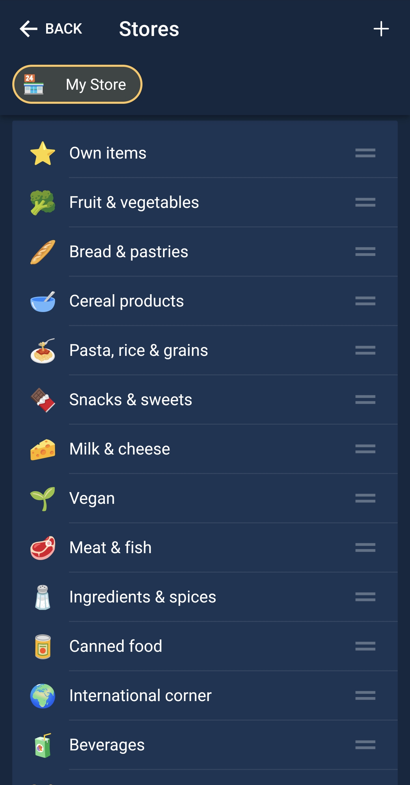

# Groceries for Nextcloud

Shared shopping lists for the whole family. Groceries is a [Nextcloud app](https://apps.nextcloud.com/apps/groceries)
that you can install on iPhone and Android like a native app.

  
  
  
  

## Features
- Items grouped by category and sorted by the aisle order of the store you are in
- Multiple lists (groceries, pharmacy, hardware store …) shared with users or groups
- List or icon grid view, history of previously bought items, 600+ built-in items with synonyms and brand names
- Available in 20 languages
- Live updates when family members add or tick items
- Install to the home screen on your phone, log in once, stay logged in (per-device app password)
- Statistics per list and a yearly review
- Works offline in the store and syncs when back online
- API for other apps (e.g. Cookbook) to add recipe ingredients

## Requirements

- Nextcloud 30–35, PHP 8.1 or newer
- HTTPS
- Nextcloud background jobs (cron), to clear the cart automatically

## Contributing

Bug reports, catalog additions, translations and pull requests are welcome. See
[CONTRIBUTING.md](CONTRIBUTING.md) and the [development guide](docs/development.md).

Please report vulnerabilities privately, see [SECURITY.md](SECURITY.md).

## Built with AI assistance

This project was written to a large extent by **Claude**, an AI model by Anthropic, used as a coding
assistant (Claude Code). That covers architecture, backend and frontend code, the item catalog, the
tests and this documentation. The project owner defined the requirements and made the product and
design decisions. Please review and test it like any other third-party code before relying on it,
and report issues.

## License

[MIT License](LICENSE). The built web app contains open source packages under their own licenses,
see [THIRD-PARTY-NOTICES.md](THIRD-PARTY-NOTICES.md).

"Nextcloud" is a trademark of Nextcloud GmbH; this app is not an official Nextcloud product. Brand
names in the item catalog are trademarks of their owners and are used only so that typed product
names are recognised.
